# Lab7Web_PHP

Praktikum 7 Pemrograman Web: Pemrograman Server-Side dengan PHP

| | |
|---|---|
| Mata kuliah | Pemrograman Web |
| Nama | Ananda Safitri |
| NIM | 312510257 |
| Kelas | I251C |

## Tujuan Praktikum

- Memahami perbedaan pemrosesan client-side dan server-side.
- Menjalankan file PHP melalui server lokal.
- Menggunakan variabel, tipe data, operator, percabangan, perulangan, dan function.
- Menerima dan memproses data form dengan metode GET dan POST.
- Melakukan validasi dan sanitasi input dasar di sisi server.
- Membuat aplikasi sederhana untuk menerima, memproses, dan menampilkan data.

## Perangkat

- Laptop/PC dan web browser
- Visual Studio Code
- PHP 8.x dan server lokal (XAMPP)

## Cara Menjalankan

Dengan XAMPP/Laragon:

1. Salin folder `Lab7Web_PHP` ke `C:\xampp\htdocs\` (atau folder `www` pada Laragon).
2. Jalankan Apache dari XAMPP Control Panel.
3. Buka `http://localhost/Lab7Web_PHP/` di browser. File PHP tidak boleh dibuka dengan klik ganda.

Alternatif tanpa XAMPP, dari terminal di dalam folder proyek:

```
php -S localhost:8000
```

lalu buka `http://localhost:8000/`.

## Struktur File

```
Lab7Web_PHP/
├── index.php                  Latihan 1
├── latihan2_nilai.php         Latihan 2
├── latihan3_array.php         Latihan 3
├── latihan4_function.php      Latihan 4
├── latihan5_cari.php          Latihan 5 (GET)
├── latihan6_post.php          Latihan 6 (POST)
├── latihan7_transaksi.php     Latihan 7
├── miniproject/
│   ├── index.php              tampilan (form dan hasil)
│   └── proses.php             pemrosesan dan validasi
├── eksperimen/
│   ├── rata_rata.php          Eksperimen 1
│   ├── cari_nama.php          Eksperimen 2
│   ├── format_rupiah.php      Eksperimen 3
│   ├── validasi_nim.php       Eksperimen 4
│   └── reset_form.php         Eksperimen 5
├── assets/style.css
├── screenshots/
└── README.md
```

## Latihan 1 - Menjalankan PHP

Kode PHP tidak tampil sebagai teks. Browser hanya menerima hasil `echo` berupa HTML, dan waktu server berubah setiap halaman dimuat ulang.

`index.php`

```php
<!DOCTYPE html>
<html lang="id">
<head>
  <meta charset="UTF-8">
  <title>Praktikum PHP</title>
  <link rel="stylesheet" href="assets/style.css">
</head>
<body>
  <h1>Belajar PHP</h1>
  <?php
    echo "<p>PHP berhasil dijalankan.</p>";
    echo "<p>Waktu server: " . date("d-m-Y H:i:s") . "</p>";
  ?>
</body>
</html>
```

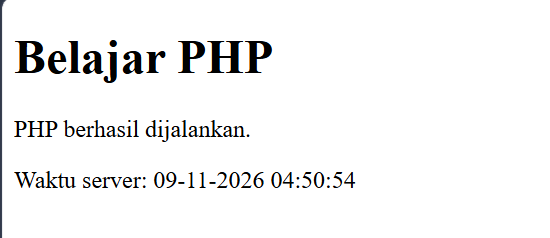

*Output index.php di browser*

## Latihan 2 - Variabel, Operator, dan Percabangan

Nilai akhir = 30% tugas + 30% UTS + 40% UAS. Untuk Siti: 25,5 + 23,4 + 36 = 84,90 sehingga predikat B. Selain data bawaan modul, ditambahkan empat kombinasi nilai untuk menguji semua predikat (A, B, C, D).

`latihan2_nilai.php`

```php
<!DOCTYPE html>
<html lang="id">
<head>
  <meta charset="UTF-8">
  <title>Latihan 2 - Nilai Akhir</title>
  <link rel="stylesheet" href="assets/style.css">
</head>
<body>
  <h2>Latihan 2 - Variabel, Operator, dan Percabangan</h2>
  <?php
  $nama = "Siti";
  $tugas = 85;
  $uts = 78;
  $uas = 90;
  $nilaiAkhir = ($tugas * 0.30) + ($uts * 0.30) + ($uas * 0.40);

  if ($nilaiAkhir >= 85) {
      $predikat = "A";
  } elseif ($nilaiAkhir >= 75) {
      $predikat = "B";
  } elseif ($nilaiAkhir >= 60) {
      $predikat = "C";
  } else {
      $predikat = "D";
  }
  echo "Nama: " . htmlspecialchars($nama) . "<br>";
  echo "Nilai akhir: " . number_format($nilaiAkhir, 2) . "<br>";
  echo "Predikat: " . $predikat;

  // Uji kombinasi nilai lain
  echo "<h3>Uji kombinasi nilai</h3>";
  $uji = [
      ["Budi",  95, 90, 92],
      ["Rina",  70, 65, 72],
      ["Dedi",  50, 55, 40],
      ["Wati",  80, 76, 79],
  ];
  echo "<table><tr><th>Nama</th><th>Tugas</th><th>UTS</th><th>UAS</th><th>Akhir</th><th>Predikat</th></tr>";
  foreach ($uji as [$n, $t, $u, $a]) {
      $akhir = ($t * 0.30) + ($u * 0.30) + ($a * 0.40);
      $p = $akhir >= 85 ? "A" : ($akhir >= 75 ? "B" : ($akhir >= 60 ? "C" : "D"));
      echo "<tr><td>" . htmlspecialchars($n) . "</td><td>$t</td><td>$u</td><td>$a</td><td>"
         . number_format($akhir, 2) . "</td><td>$p</td></tr>";
  }
  echo "</table>";
  ?>
</body>
</html>
```

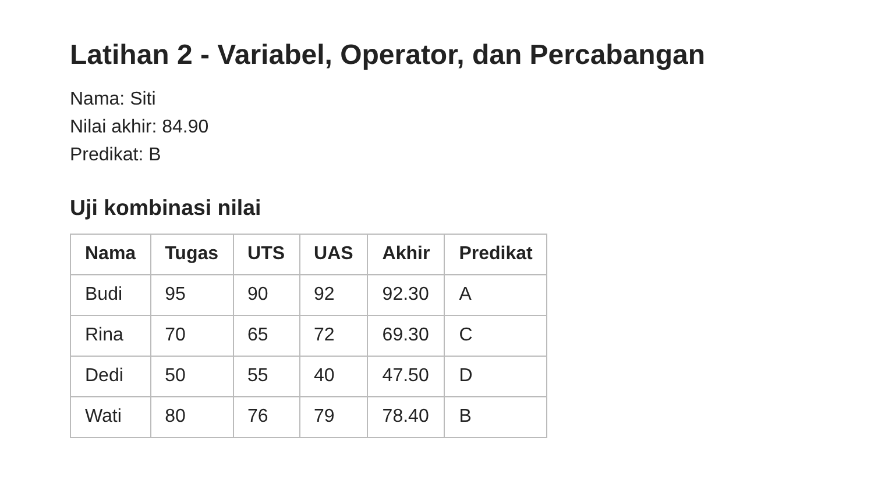

*Nilai akhir Siti dan uji beberapa kombinasi nilai*

## Latihan 3 - Perulangan dan Array

Array berisi tujuh nama (lebih dari tiga nama yang diminta) ditampilkan dengan `foreach`.

`latihan3_array.php`

```php
<!DOCTYPE html>
<html lang="id">
<head>
  <meta charset="UTF-8">
  <title>Latihan 3 - Array</title>
  <link rel="stylesheet" href="assets/style.css">
</head>
<body>
  <h2>Latihan 3 - Perulangan dan Array</h2>
  <?php
  $mahasiswa = ["Alya", "Bima", "Citra", "Doni", "Eka", "Fajar", "Gita"];
  echo "<h3>Daftar Mahasiswa</h3><ol>";
  foreach ($mahasiswa as $nama) {
      echo "<li>" . htmlspecialchars($nama) . "</li>";
  }
  echo "</ol>";
  echo "<p>Jumlah mahasiswa: " . count($mahasiswa) . "</p>";
  ?>
</body>
</html>
```

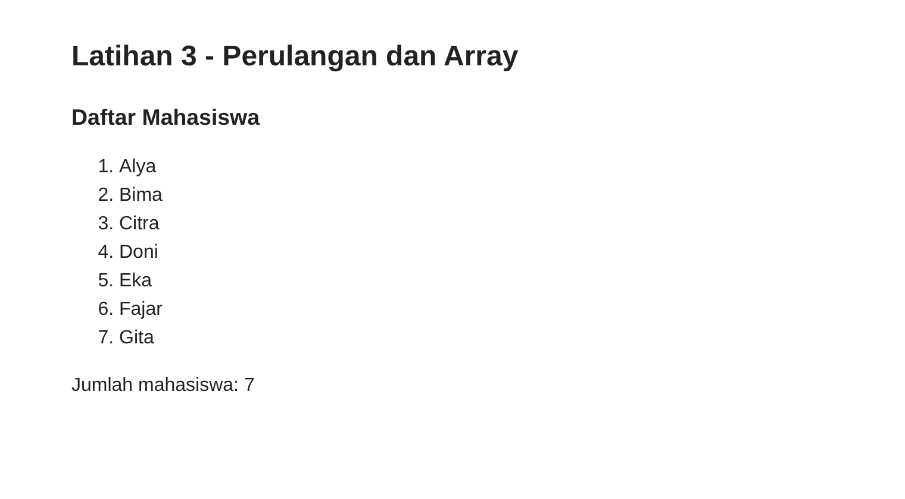

*Daftar mahasiswa dengan foreach*

## Latihan 4 - Function

Selain `hitungDiskon()`, dibuat `hitungLuasPersegiPanjang()` dan `tentukanKelulusan()`. Diskon 10% dari Rp150.000 menghasilkan Rp135.000.

`latihan4_function.php`

```php
<!DOCTYPE html>
<html lang="id">
<head>
  <meta charset="UTF-8">
  <title>Latihan 4 - Function</title>
  <link rel="stylesheet" href="assets/style.css">
</head>
<body>
  <h2>Latihan 4 - Membuat Function</h2>
  <?php
  function hitungDiskon($harga, $persen) {
      $potongan = $harga * ($persen / 100);
      return $harga - $potongan;
  }

  // function tambahan
  function hitungLuasPersegiPanjang($panjang, $lebar) {
      return $panjang * $lebar;
  }

  function tentukanKelulusan($nilai) {
      return $nilai >= 60 ? "Lulus" : "Tidak Lulus";
  }

  $hargaAkhir = hitungDiskon(150000, 10);
  echo "Harga setelah diskon: Rp" . number_format($hargaAkhir, 0, ",", ".") . "<br>";
  echo "Luas persegi panjang 8 x 4: " . hitungLuasPersegiPanjang(8, 4) . "<br>";
  echo "Nilai 72: " . tentukanKelulusan(72) . "<br>";
  echo "Nilai 45: " . tentukanKelulusan(45) . "<br>";
  ?>
</body>
</html>
```

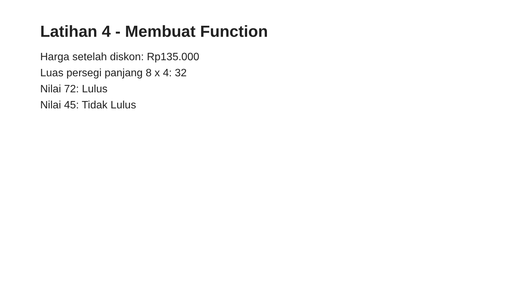

*Output function diskon, luas, dan kelulusan*

## Latihan 5 - Form GET

Setelah form dikirim, data muncul di URL sebagai parameter `?kata=...`. Karena itu GET tidak cocok untuk kata sandi atau data sensitif.

`latihan5_cari.php`

```php
<!DOCTYPE html>
<html lang="id">
<head>
  <meta charset="UTF-8">
  <title>Latihan 5 - Form GET</title>
  <link rel="stylesheet" href="assets/style.css">
</head>
<body>
  <h2>Latihan 5 - Form dengan Metode GET</h2>
  <form method="GET" action="">
    <label for="kata">Kata kunci:</label>
    <input id="kata" name="kata" type="text">
    <button type="submit">Cari</button>
  </form>
  <?php
  if (isset($_GET["kata"])) {
      $kata = trim($_GET["kata"]);
      echo "Kata kunci: " . htmlspecialchars($kata, ENT_QUOTES, "UTF-8");
  }
  ?>
</body>
</html>
```

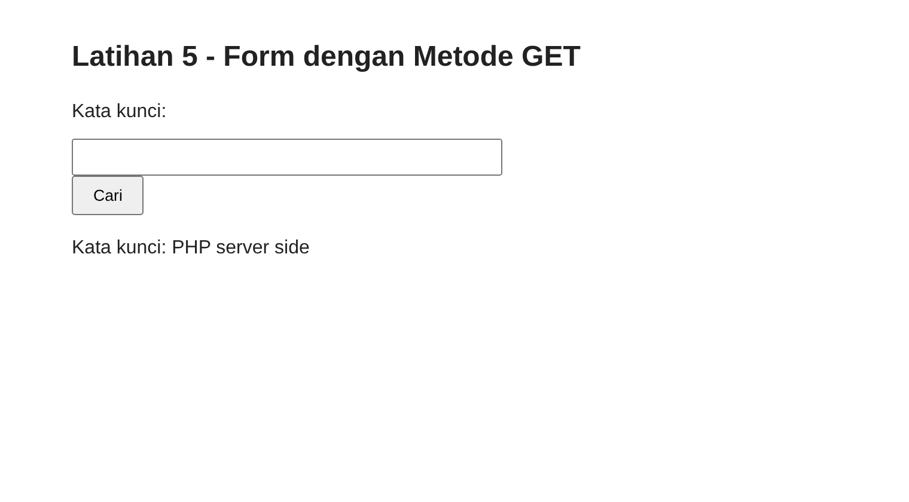

*Hasil pencarian; alamat halaman berubah menjadi latihan5_cari.php?kata=PHP+server+side*

## Latihan 6 - Form POST

Data dikirim lewat body request sehingga tidak tampil di URL. Input berisi tanda kutip dan tag HTML ditampilkan apa adanya sebagai teks berkat `htmlspecialchars()`, sehingga skrip tidak dieksekusi. Kolom `required` pada HTML hanya membantu pengguna; pemeriksaan kosong tetap dilakukan di PHP.

`latihan6_post.php`

```php
<!DOCTYPE html>
<html lang="id">
<head>
  <meta charset="UTF-8">
  <title>Latihan 6 - Form POST</title>
  <link rel="stylesheet" href="assets/style.css">
</head>
<body>
  <h2>Latihan 6 - Form dengan Metode POST</h2>
  <form method="POST" action="">
    <label for="nama">Nama:</label>
    <input id="nama" name="nama" type="text" required>
    <label for="prodi">Program Studi:</label>
    <input id="prodi" name="prodi" type="text" required>
    <button type="submit" name="kirim">Kirim Data</button>
  </form>

  <?php
  if ($_SERVER["REQUEST_METHOD"] === "POST") {
      $nama = trim($_POST["nama"] ?? "");
      $prodi = trim($_POST["prodi"] ?? "");

      if ($nama === "" || $prodi === "") {
          echo "<p class='error'>Semua kolom wajib diisi.</p>";
      } else {
          echo "<div class='sukses'><h3>Data diterima</h3>";
          echo "Nama: " . htmlspecialchars($nama, ENT_QUOTES, "UTF-8") . "<br>";
          echo "Program Studi: " . htmlspecialchars($prodi, ENT_QUOTES, "UTF-8") . "</div>";
      }
  }
  ?>
</body>
</html>
```

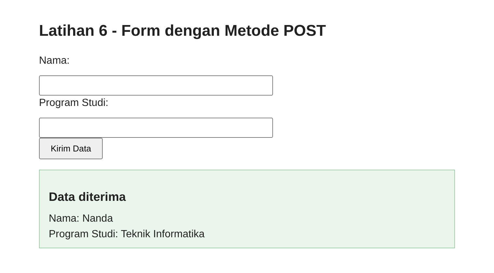

*Input lengkap*

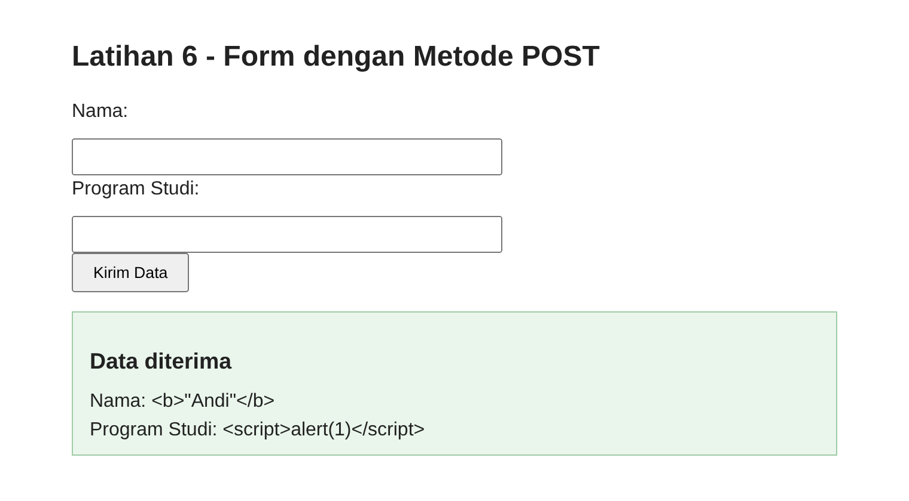

*Input berisi tag HTML tampil sebagai teks biasa*

## Latihan 7 - Pengolahan Data Sederhana

Pada form ditambahkan atribut `novalidate` agar validasi browser tidak menghalangi, sehingga pemeriksaan sisi server bisa diuji dengan jumlah nol, negatif, atau data tidak sesuai.

`latihan7_transaksi.php`

```php
<?php
$hasil = null;
if ($_SERVER["REQUEST_METHOD"] === "POST") {
    $barang = trim($_POST["barang"] ?? "");
    $hargaInput = $_POST["harga"] ?? "";
    $jumlahInput = $_POST["jumlah"] ?? "";

    if ($barang === "" || !is_numeric($hargaInput) ||
        !ctype_digit((string)$jumlahInput) ||
        (float)$hargaInput < 0 || (int)$jumlahInput < 1) {
        $error = "Periksa kembali nama barang, harga, dan jumlah.";
    } else {
        $harga = (float)$hargaInput;
        $jumlah = (int)$jumlahInput;
        $subtotal = $harga * $jumlah;
    }
}
?>
<!DOCTYPE html>
<html lang="id">
<head>
  <meta charset="UTF-8">
  <title>Latihan 7 - Transaksi</title>
  <link rel="stylesheet" href="assets/style.css">
</head>
<body>
  <h2>Latihan 7 - Pengolahan Data Sederhana</h2>
  <form method="POST" novalidate>
    <label>Nama barang <input name="barang" value="<?= htmlspecialchars($_POST['barang'] ?? '') ?>"></label>
    <label>Harga <input name="harga" type="number" min="0" step="0.01" value="<?= htmlspecialchars($_POST['harga'] ?? '') ?>"></label>
    <label>Jumlah <input name="jumlah" type="number" min="1" step="1" value="<?= htmlspecialchars($_POST['jumlah'] ?? '') ?>"></label>
    <button type="submit">Hitung</button>
  </form>
  <?php
  if (isset($error)) {
      echo "<p class='error'>" . htmlspecialchars($error) . "</p>";
  } elseif (isset($subtotal)) {
      echo "<div class='sukses'>";
      echo "<p>Barang: " . htmlspecialchars($barang) . "</p>";
      echo "<p>Subtotal: Rp" . number_format($subtotal, 0, ",", ".") . "</p>";
      echo "</div>";
  }
  ?>
</body>
</html>
```

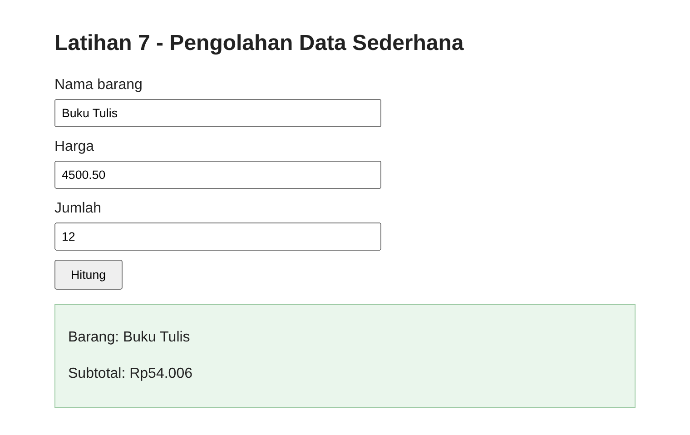

*Harga desimal dan jumlah valid*

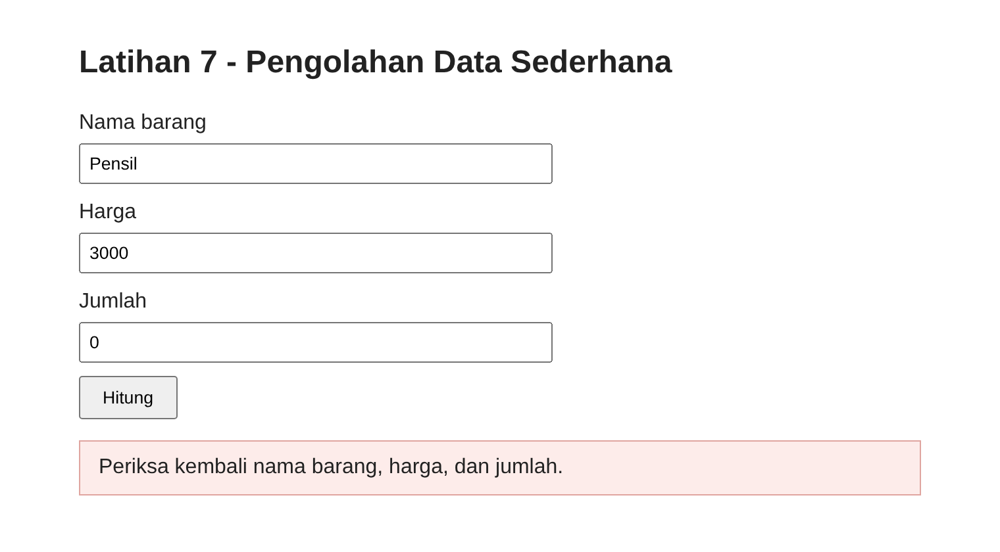

*Jumlah 0 ditolak server*

## Mini Project - Formulir Data Mahasiswa

Pemrosesan dipisah dari tampilan: `proses.php` hanya berisi logika validasi, sedangkan `index.php` memuatnya dengan `require` lalu menampilkan form, pesan error, atau ringkasan data.

`miniproject/proses.php`

```php
<?php
// Bagian pemrosesan data (tanpa HTML)
$data = null;
$error = [];
$old = ["nama" => "", "nim" => "", "prodi" => "", "semester" => "", "email" => ""];

if ($_SERVER["REQUEST_METHOD"] === "POST") {
    $nama = trim($_POST["nama"] ?? "");
    $nim = trim($_POST["nim"] ?? "");
    $prodi = trim($_POST["prodi"] ?? "");
    $semesterInput = $_POST["semester"] ?? "";
    $email = trim($_POST["email"] ?? "");

    $old = ["nama" => $nama, "nim" => $nim, "prodi" => $prodi,
            "semester" => $semesterInput, "email" => $email];

    if ($nama === "") $error[] = "Nama wajib diisi.";
    if ($nim === "") $error[] = "NIM wajib diisi.";
    if ($prodi === "") $error[] = "Program studi wajib diisi.";
    if (!filter_var($email, FILTER_VALIDATE_EMAIL)) {
        $error[] = "Format email tidak valid.";
    }
    if (!ctype_digit((string)$semesterInput) ||
        (int)$semesterInput < 1 || (int)$semesterInput > 14) {
        $error[] = "Semester harus berupa angka 1–14.";
    }

    if (!$error) {
        $data = compact("nama", "nim", "prodi", "email");
        $data["semester"] = (int)$semesterInput;
    }
}
```

`miniproject/index.php`

```php
<?php require __DIR__ . "/proses.php"; ?>
<!DOCTYPE html>
<html lang="id">
<head>
  <meta charset="UTF-8">
  <title>Formulir Data Mahasiswa</title>
  <link rel="stylesheet" href="../assets/style.css">
</head>
<body>
  <h2>Formulir Data Mahasiswa</h2>

  <?php if ($error): ?>
    <div class="error">
      <strong>Data belum dapat diproses:</strong>
      <ul>
        <?php foreach ($error as $pesan): ?>
          <li><?= htmlspecialchars($pesan, ENT_QUOTES, "UTF-8") ?></li>
        <?php endforeach; ?>
      </ul>
    </div>
  <?php endif; ?>

  <?php if ($data): ?>
    <div class="sukses">
      <h3>Ringkasan Data Mahasiswa</h3>
      <table>
        <tr><th>Nama</th><td><?= htmlspecialchars($data["nama"], ENT_QUOTES, "UTF-8") ?></td></tr>
        <tr><th>NIM</th><td><?= htmlspecialchars($data["nim"], ENT_QUOTES, "UTF-8") ?></td></tr>
        <tr><th>Program Studi</th><td><?= htmlspecialchars($data["prodi"], ENT_QUOTES, "UTF-8") ?></td></tr>
        <tr><th>Semester</th><td><?= (int)$data["semester"] ?></td></tr>
        <tr><th>Email</th><td><?= htmlspecialchars($data["email"], ENT_QUOTES, "UTF-8") ?></td></tr>
      </table>
    </div>
  <?php endif; ?>

  <form method="POST" action="" novalidate>
    <label>Nama
      <input type="text" name="nama" value="<?= htmlspecialchars($old['nama'], ENT_QUOTES, 'UTF-8') ?>">
    </label>
    <label>NIM
      <input type="text" name="nim" value="<?= htmlspecialchars($old['nim'], ENT_QUOTES, 'UTF-8') ?>">
    </label>
    <label>Program Studi
      <input type="text" name="prodi" value="<?= htmlspecialchars($old['prodi'], ENT_QUOTES, 'UTF-8') ?>">
    </label>
    <label>Semester
      <input type="text" name="semester" value="<?= htmlspecialchars((string)$old['semester'], ENT_QUOTES, 'UTF-8') ?>">
    </label>
    <label>Email
      <input type="text" name="email" value="<?= htmlspecialchars($old['email'], ENT_QUOTES, 'UTF-8') ?>">
    </label>
    <button type="submit">Kirim</button>
  </form>
</body>
</html>
```

### Kasus uji

| No | Input | Hasil |
|---|---|---|
| 1 | Nanda Putri, 2411001234, Teknik Informatika, semester 3, nanda@mail.com | Valid, ringkasan tampil |
| 2 | Rafi, 2411005678, Sistem Informasi, semester 7, rafi@kampus.ac.id | Valid, ringkasan tampil |
| 3 | Nama dan NIM kosong, semester 20, email `bukan-email` | Tidak valid, 4 pesan error tampil |
| 4 | Dina, semester `abc`, email `dina@mail` | Tidak valid, error semester dan email |

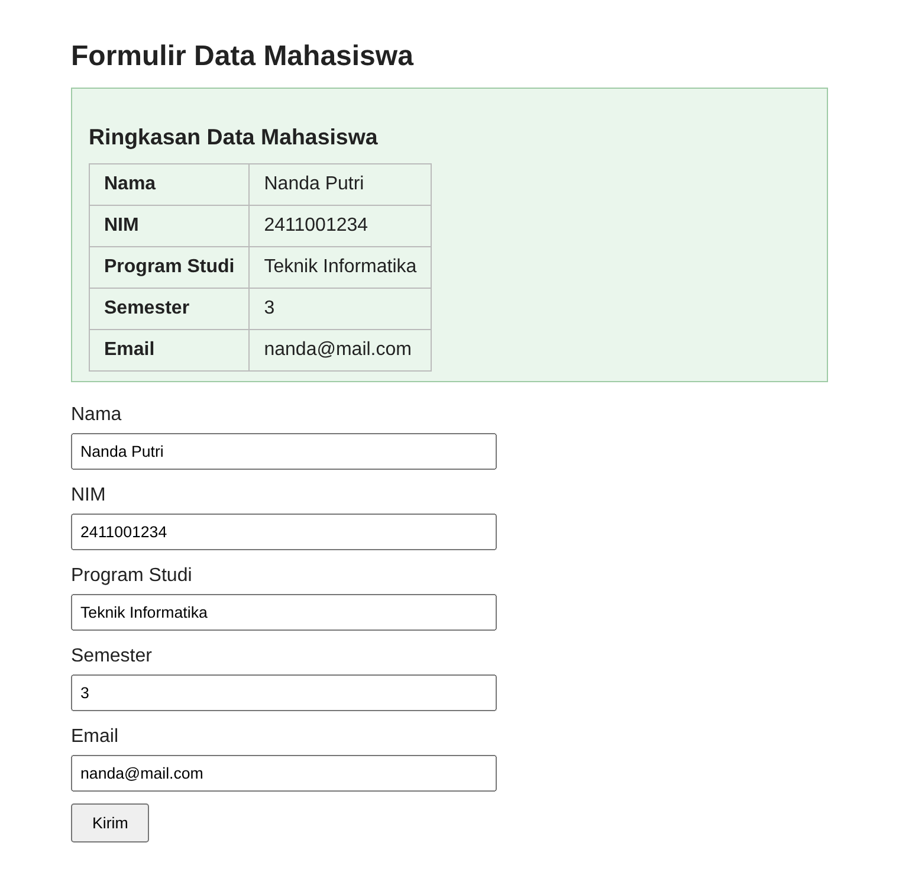

*Input valid 1*

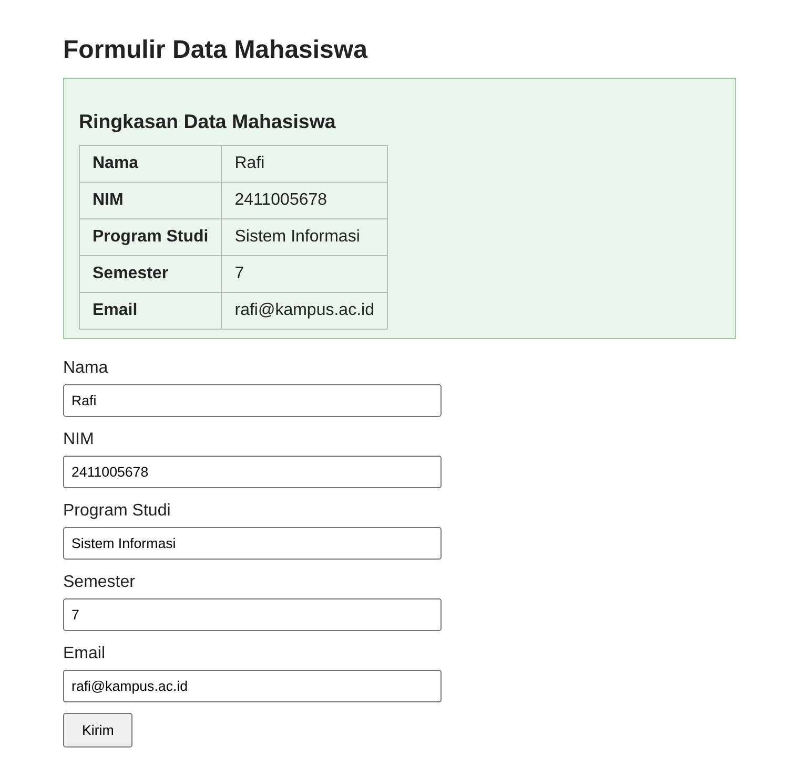

*Input valid 2*

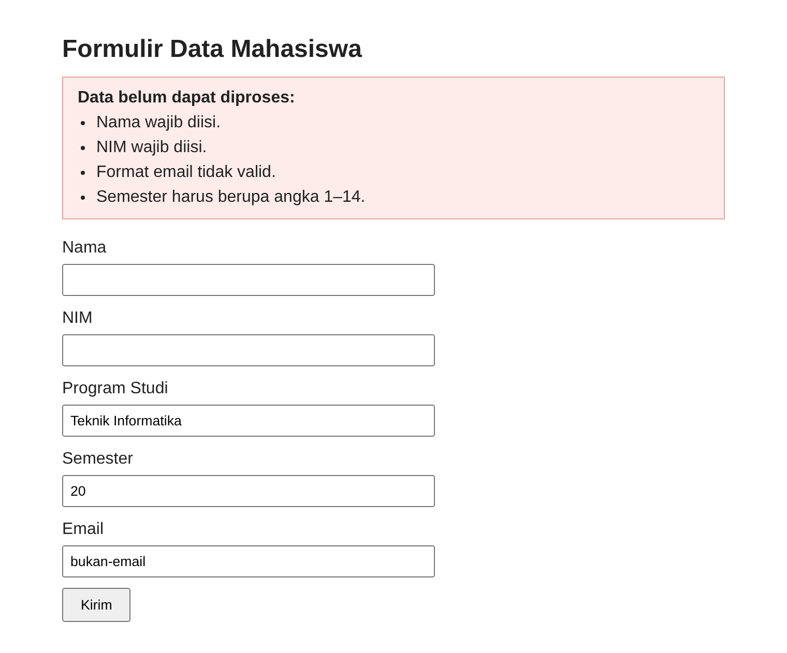

*Input tidak valid 1 (nama/NIM kosong, semester 20, email salah)*

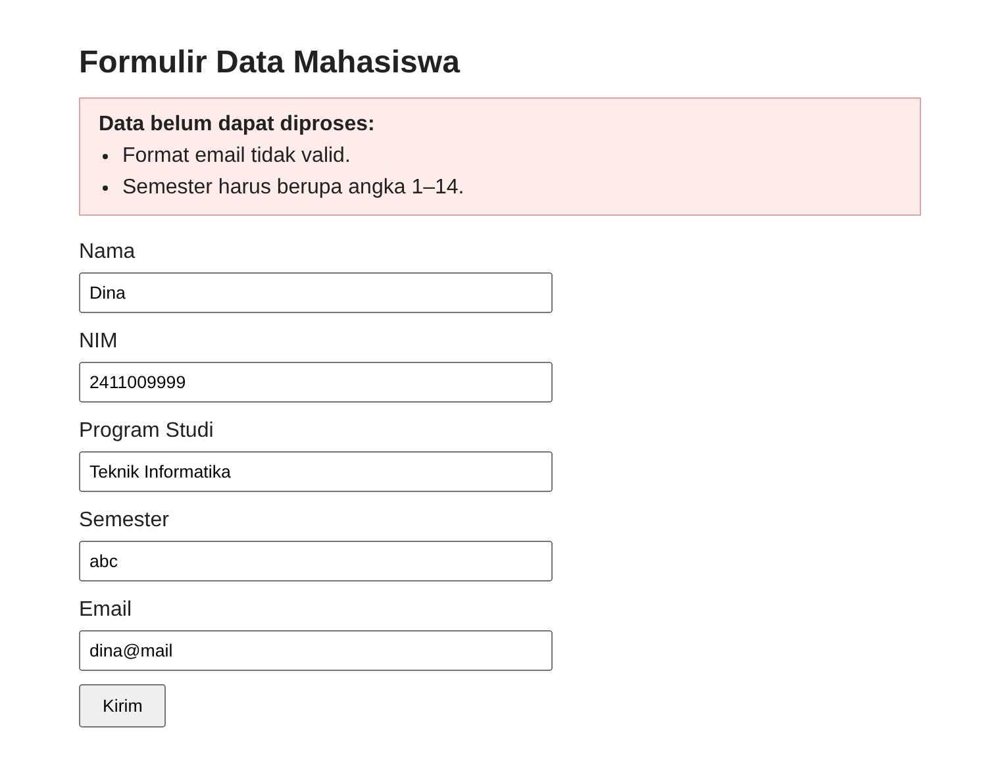

*Input tidak valid 2 (semester bukan angka, email tanpa domain lengkap)*

## Eksperimen Mandiri

### 1. Rata-rata tiga komponen nilai

(80 + 75 + 90) / 3 = 81,67.

`eksperimen/rata_rata.php`

```php
<?php
function hitungRataRata(float $a, float $b, float $c): float {
    return ($a + $b + $c) / 3;
}

$hasil = null;
$error = "";
if ($_SERVER["REQUEST_METHOD"] === "POST") {
    $n = [$_POST["nilai1"] ?? "", $_POST["nilai2"] ?? "", $_POST["nilai3"] ?? ""];
    $valid = true;
    foreach ($n as $x) {
        if (!is_numeric($x) || $x < 0 || $x > 100) $valid = false;
    }
    if ($valid) {
        $hasil = hitungRataRata((float)$n[0], (float)$n[1], (float)$n[2]);
    } else {
        $error = "Semua nilai harus berupa angka 0–100.";
    }
}
?>
<!DOCTYPE html>
<html lang="id">
<head>
  <meta charset="UTF-8">
  <title>Eksperimen 1 - Rata-rata Nilai</title>
  <link rel="stylesheet" href="../assets/style.css">
</head>
<body>
  <h2>Eksperimen 1 - Rata-rata Tiga Komponen Nilai</h2>
  <form method="POST">
    <label>Nilai Tugas <input type="text" name="nilai1" value="<?= htmlspecialchars($_POST['nilai1'] ?? '') ?>"></label>
    <label>Nilai UTS <input type="text" name="nilai2" value="<?= htmlspecialchars($_POST['nilai2'] ?? '') ?>"></label>
    <label>Nilai UAS <input type="text" name="nilai3" value="<?= htmlspecialchars($_POST['nilai3'] ?? '') ?>"></label>
    <button type="submit">Hitung</button>
  </form>
  <?php if ($error): ?>
    <p class="error"><?= htmlspecialchars($error) ?></p>
  <?php elseif ($hasil !== null): ?>
    <p class="sukses">Nilai rata-rata: <?= number_format($hasil, 2) ?></p>
  <?php endif; ?>
</body>
</html>
```

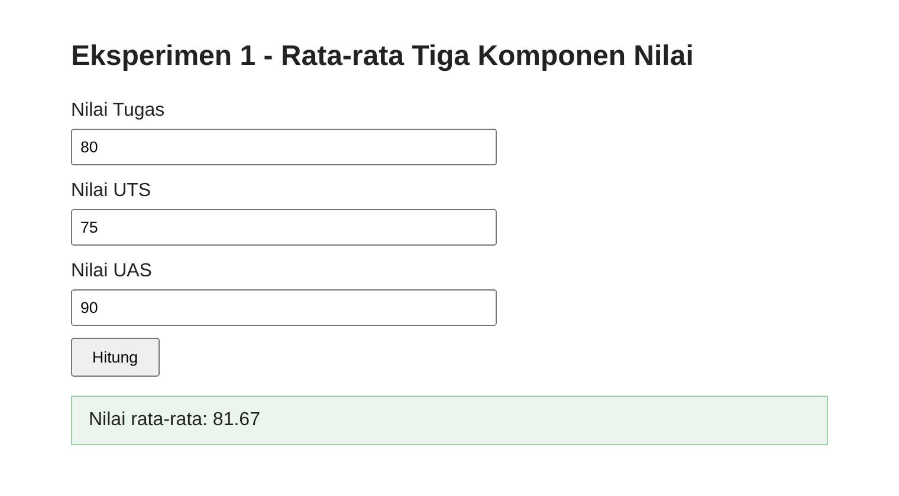

### 2. Cari nama dari array dengan GET

Pencarian "alya" tidak peduli huruf besar/kecil (`stripos`) dan menemukan dua nama.

`eksperimen/cari_nama.php`

```php
<?php
$daftar = ["Alya Putri", "Bima Saputra", "Citra Lestari", "Doni Prakoso", "Eka Wulandari", "Alya Rahma"];
$kata = trim($_GET["kata"] ?? "");
$ditemukan = [];

if ($kata !== "") {
    foreach ($daftar as $nama) {
        if (stripos($nama, $kata) !== false) {
            $ditemukan[] = $nama;
        }
    }
}
?>
<!DOCTYPE html>
<html lang="id">
<head>
  <meta charset="UTF-8">
  <title>Eksperimen 2 - Cari Nama</title>
  <link rel="stylesheet" href="../assets/style.css">
</head>
<body>
  <h2>Eksperimen 2 - Cari Nama dengan GET</h2>
  <form method="GET" action="">
    <label for="kata">Cari nama:</label>
    <input id="kata" name="kata" type="text" value="<?= htmlspecialchars($kata, ENT_QUOTES, 'UTF-8') ?>">
    <button type="submit">Cari</button>
  </form>

  <?php if ($kata !== ""): ?>
    <p>Hasil pencarian untuk "<?= htmlspecialchars($kata, ENT_QUOTES, "UTF-8") ?>":</p>
    <?php if ($ditemukan): ?>
      <ol>
        <?php foreach ($ditemukan as $n): ?>
          <li><?= htmlspecialchars($n) ?></li>
        <?php endforeach; ?>
      </ol>
    <?php else: ?>
      <p>Nama tidak ditemukan.</p>
    <?php endif; ?>
  <?php endif; ?>

  <p><small>Data yang dicari: <?= htmlspecialchars(implode(", ", $daftar)) ?></small></p>
</body>
</html>
```

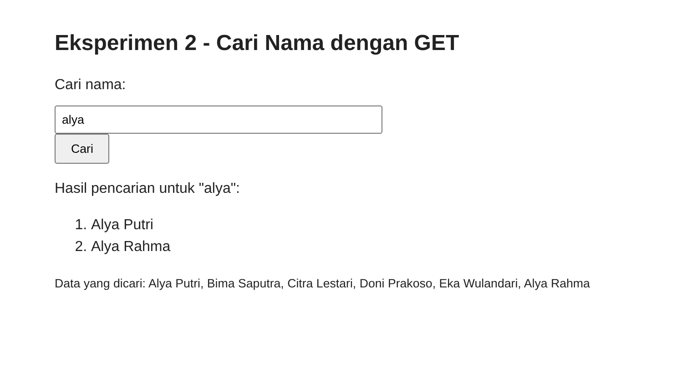

### 3. Function format Rupiah

`formatRupiah()` memakai `number_format()` dengan titik sebagai pemisah ribuan.

`eksperimen/format_rupiah.php`

```php
<?php
function formatRupiah($angka) {
    return "Rp" . number_format($angka, 0, ",", ".");
}
?>
<!DOCTYPE html>
<html lang="id">
<head>
  <meta charset="UTF-8">
  <title>Eksperimen 3 - Format Rupiah</title>
  <link rel="stylesheet" href="../assets/style.css">
</head>
<body>
  <h2>Eksperimen 3 - Function Format Rupiah</h2>
  <table>
    <tr><th>Angka</th><th>Hasil formatRupiah()</th></tr>
    <?php foreach ([2500, 15000, 150000, 1250000, 99999999] as $a): ?>
      <tr><td><?= $a ?></td><td><?= formatRupiah($a) ?></td></tr>
    <?php endforeach; ?>
  </table>
</body>
</html>
```

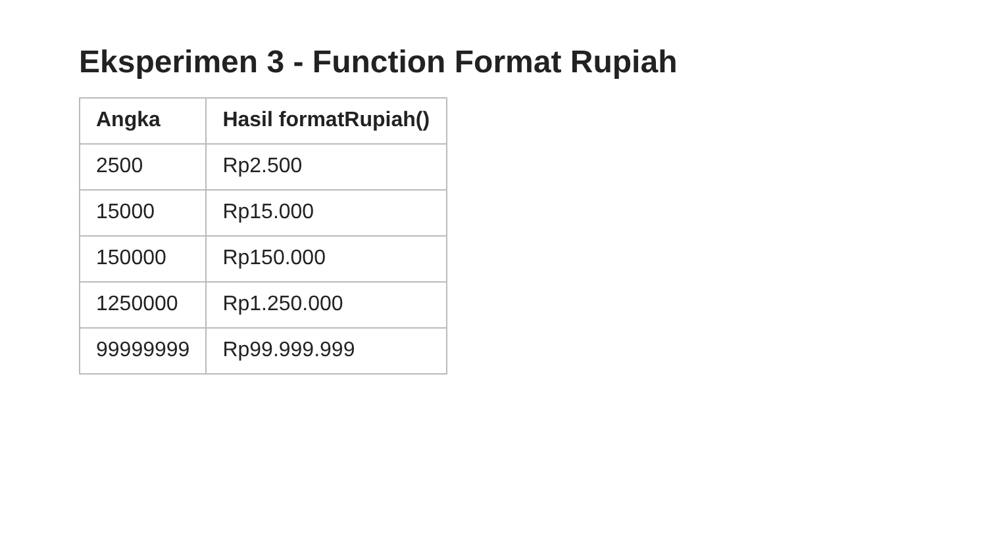

### 4. Validasi NIM

Ketentuan yang saya tetapkan: hanya angka dan tepat 10 digit. Input `24110A1234` ditolak karena ada huruf.

`eksperimen/validasi_nim.php`

```php
<?php
// Ketentuan: NIM hanya angka dan panjangnya tepat 10 digit
const PANJANG_NIM = 10;

$pesan = "";
$valid = false;
$nim = "";

if ($_SERVER["REQUEST_METHOD"] === "POST") {
    $nim = trim($_POST["nim"] ?? "");
    if ($nim === "") {
        $pesan = "NIM wajib diisi.";
    } elseif (!ctype_digit($nim)) {
        $pesan = "NIM hanya boleh berisi angka.";
    } elseif (strlen($nim) !== PANJANG_NIM) {
        $pesan = "NIM harus tepat " . PANJANG_NIM . " digit.";
    } else {
        $valid = true;
        $pesan = "NIM valid.";
    }
}
?>
<!DOCTYPE html>
<html lang="id">
<head>
  <meta charset="UTF-8">
  <title>Eksperimen 4 - Validasi NIM</title>
  <link rel="stylesheet" href="../assets/style.css">
</head>
<body>
  <h2>Eksperimen 4 - Validasi NIM</h2>
  <p>Ketentuan: hanya angka, panjang <?= PANJANG_NIM ?> digit.</p>
  <form method="POST">
    <label>NIM <input type="text" name="nim" value="<?= htmlspecialchars($nim, ENT_QUOTES, 'UTF-8') ?>"></label>
    <button type="submit">Periksa</button>
  </form>
  <?php if ($pesan): ?>
    <p class="<?= $valid ? 'sukses' : 'error' ?>"><?= htmlspecialchars($pesan) ?></p>
  <?php endif; ?>
</body>
</html>
```

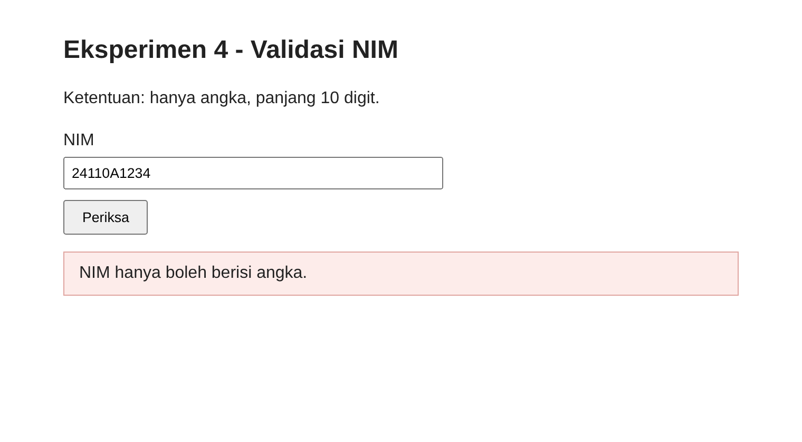

### 5. Tombol reset

Reset hanya bekerja di browser dan tidak mengirim apa pun ke server, sedangkan submit membuat server memproses ulang data dan membangun halaman baru.

`eksperimen/reset_form.php`

```php
<?php
$nama = trim($_POST["nama"] ?? "");
$kota = trim($_POST["kota"] ?? "");
$dikirim = $_SERVER["REQUEST_METHOD"] === "POST";
?>
<!DOCTYPE html>
<html lang="id">
<head>
  <meta charset="UTF-8">
  <title>Eksperimen 5 - Tombol Reset</title>
  <link rel="stylesheet" href="../assets/style.css">
</head>
<body>
  <h2>Eksperimen 5 - Tombol Reset</h2>
  <form method="POST" action="">
    <label>Nama <input type="text" name="nama" value="<?= htmlspecialchars($nama, ENT_QUOTES, 'UTF-8') ?>"></label>
    <label>Kota <input type="text" name="kota" value="<?= htmlspecialchars($kota, ENT_QUOTES, 'UTF-8') ?>"></label>
    <button type="submit">Kirim</button>
    <button type="reset">Reset</button>
    <a href="reset_form.php">Muat ulang dari server</a>
  </form>

  <?php if ($dikirim): ?>
    <p class="sukses">Server menerima: <?= htmlspecialchars($nama) ?> / <?= htmlspecialchars($kota) ?></p>
  <?php endif; ?>

  <p><small>
    Tombol Reset hanya mengembalikan isian ke nilai awal di browser tanpa mengirim apa pun ke server.
    Karena form ini mengisi ulang kolom dengan data hasil POST, Reset mengembalikannya ke nilai tersebut,
    bukan mengosongkannya. Untuk mengosongkan sepenuhnya, halaman perlu diminta ulang ke server (tautan di atas).
  </small></p>
</body>
</html>
```

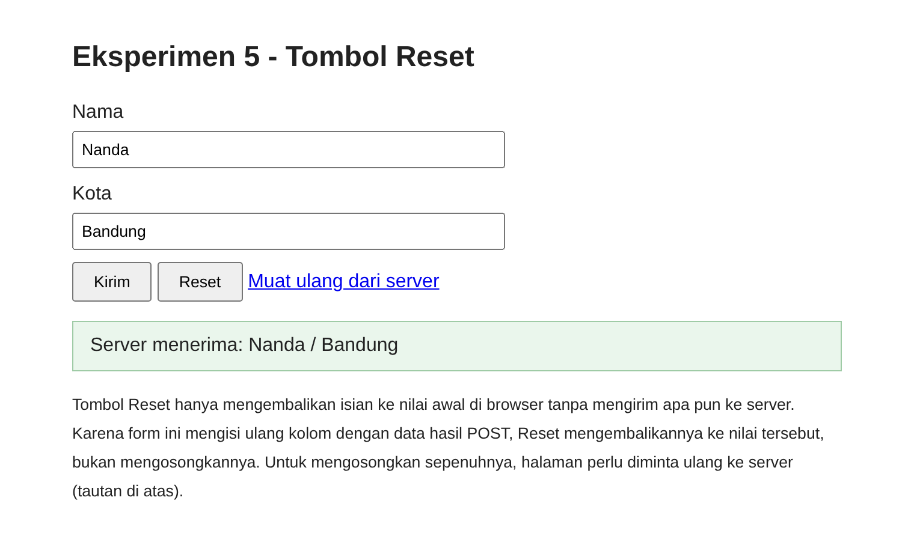

## Jawaban Pertanyaan Evaluasi

1. **Client-side vs server-side.** Client-side dijalankan di browser pengguna (HTML, CSS, JavaScript). Server-side dijalankan di server (PHP): menerima request, memproses, lalu mengirim hasilnya ke browser.
2. **Mengapa PHP harus lewat web server?** Browser tidak bisa menjalankan PHP. Web server dengan interpreter PHP yang mengeksekusi kode dan mengirim hasil HTML. Kalau file dibuka dengan klik ganda, kode PHP hanya tampil sebagai teks.
3. **Fungsi tanda `$`.** Penanda bahwa nama tersebut adalah variabel, misalnya `$nama`.
4. **GET vs POST.** GET mengirim data lewat URL, terlihat, dan cocok untuk permintaan yang tidak mengubah data seperti pencarian. POST mengirim data di body request dan lazim dipakai untuk form. POST bukan enkripsi, jadi tetap perlu HTTPS.
5. **Mengapa validasi di server.** Validasi di browser (misalnya `required`) mudah dilewati, misalnya dengan mengubah HTML atau mengirim request langsung. Server harus memeriksa sendiri agar data yang diproses tetap benar dan aman.
6. **Fungsi `htmlspecialchars()`.** Mengubah karakter khusus seperti `<`, `>`, `&`, dan tanda kutip menjadi entitas HTML sehingga input pengguna tampil sebagai teks dan tidak dieksekusi sebagai HTML atau script (mengurangi risiko XSS).
7. **Manfaat function.** Kode bisa dipakai berulang, program lebih rapi dan mudah dibaca, serta perbaikan cukup dilakukan di satu tempat.

## Ringkasan

Semua latihan, mini project, dan eksperimen dijalankan lewat server lokal dan outputnya sesuai harapan. Input valid diproses dan ditampilkan, sedangkan input kosong, di luar rentang, atau berformat salah ditolak oleh validasi PHP. Karakter HTML pada input tampil sebagai teks biasa.
